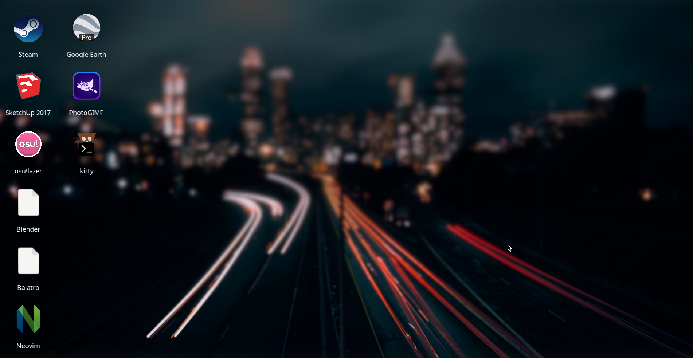

# Waygraph

A wayland wlr-layer-shell based desktop icon layer.

## Progress

This project is currently in development and is expected to have innovative new features in the future. Currently it supports the following:

- Reading entries from $HOME/Desktop/*.desktop
- Font rendering
- Icon rendering
- Application launch

For more check: [TODO.md](TODO.md)

## How to run

Just use `cargo run --release`

## Notes

Credits to LibAdwaita for assets/application-x-generic.png

No AI policy: Every single line of code is hand written

GPL v3 Licensed. Read [LICENSE.md](LICENSE.md)
